# Skins

Fretdrom has four built-in skins. Select one via the `--skin` CLI flag or the `config.skin` key inside your JSON5 source.

```bash
fretdrom -i chord.json5 --skin sketch > chord.svg
```

```json5
{ chord: { name: "C Major", frets: "x32010", config: { skin: "sketch" } } }
```

---

## default

Light background, charcoal lines, red root notes.

| Chord | Barre | Scale | Tab |
|-------|-------|-------|-----|
| 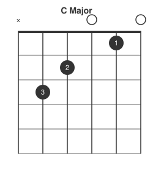 | 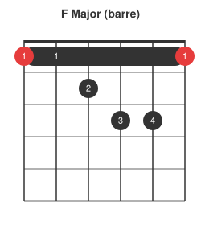 | 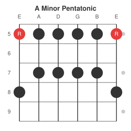 | 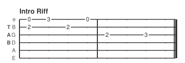 |

---

## dark

Dark background, light lines, bright red root notes.

| Chord | Barre | Scale | Tab |
|-------|-------|-------|-----|
| 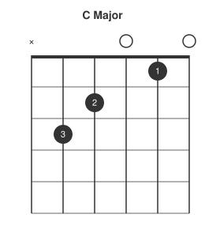 | 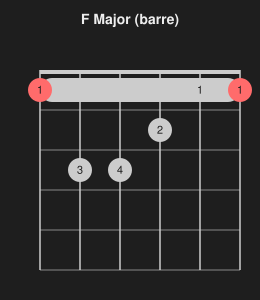 | 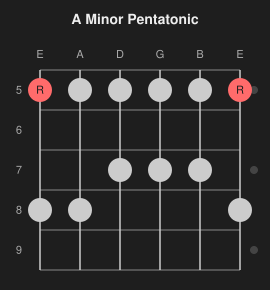 | 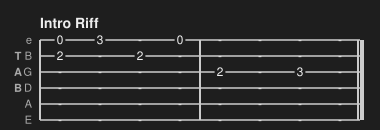 |

---

## sketch

Warm off-white background with hand-drawn wobbly lines. Fret wires, strings, and the nut are rendered as deterministic cubic bezier paths instead of straight lines -- the same source always produces the same SVG.

| Chord | Barre | Scale | Tab |
|-------|-------|-------|-----|
| 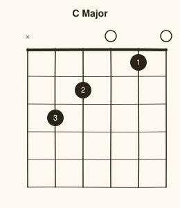 | 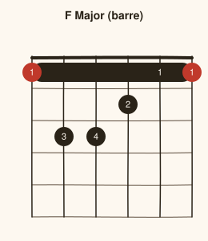 | 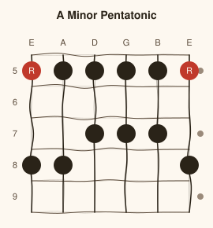 | 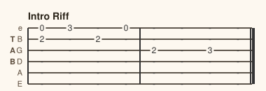 |

---

## sketch-dark

Dark background with the same hand-drawn line style.

| Chord | Barre | Scale | Tab |
|-------|-------|-------|-----|
| 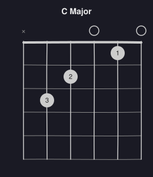 | 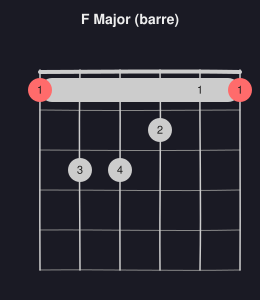 | 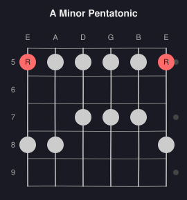 | 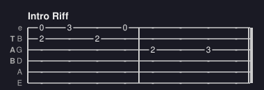 |

---

## Chord rows

A `chords` row inherits the skin of the whole diagram, so one `config.skin` styles every chord in it. Rows are too wide for a side-by-side table, so the four skins are stacked here.

```json5
{
  config: { skin: "sketch" },
  chords: [
    { name: "A Minor", frets: "x02210", fingers: "--231-" },
    { name: "C Major", frets: "x32010", fingers: "-32-1-" },
    { name: "G Major", frets: "320003", fingers: "21---3" }
  ]
}
```

**default**

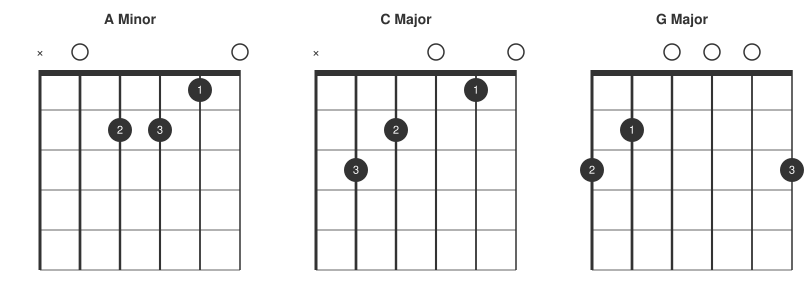

**dark**

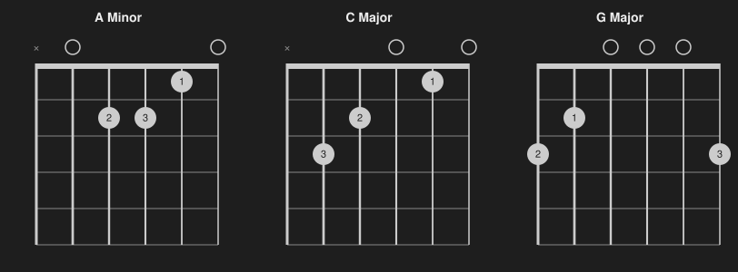

**sketch**

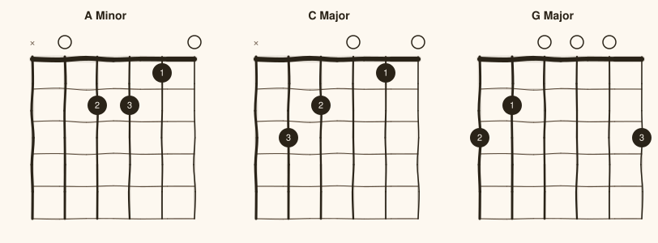

**sketch-dark**

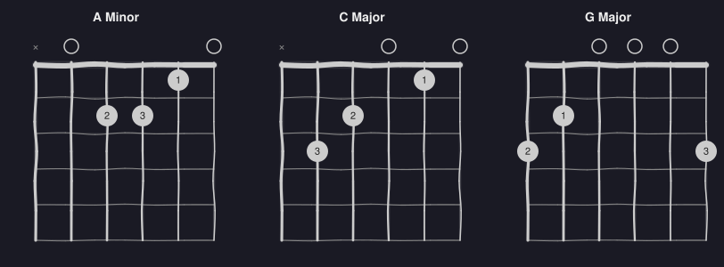

An entry can carry its own `config` to override the row's skin for that diagram alone -- useful for picking out one chord in a progression:

```json5
{
  config: { skin: "sketch" },
  chords: [
    { name: "A Minor", frets: "x02210" },
    { name: "C Major", frets: "x32010", config: { skin: "sketch-dark" } }
  ]
}
```

The gap between diagrams is the `chord_row_gap` skin key (default `16`), on top of each diagram's own margins.

---

## Combining skins with other features

Skins compose with all other diagram features -- intervals, subtitles, barre chords, and tunings all work the same way regardless of skin.

```json5
{ chord: {
  name: "E Major",
  frets:     "022100",
  intervals: ["R", "5", "R", "3", "5", "R"],
  config:    { skin: "sketch" }
}}
```
